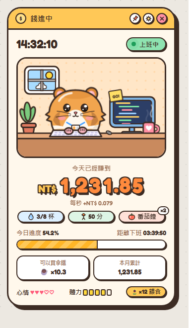
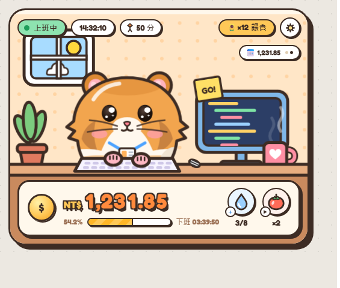
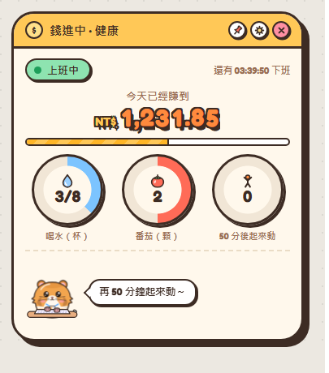
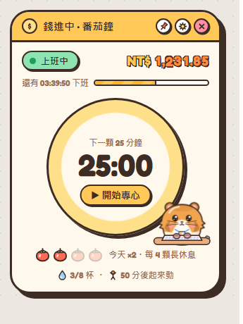
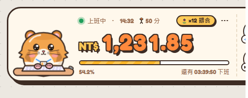
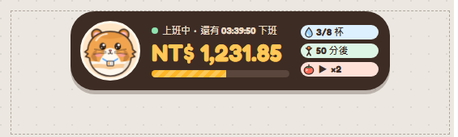
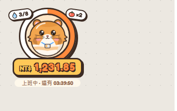
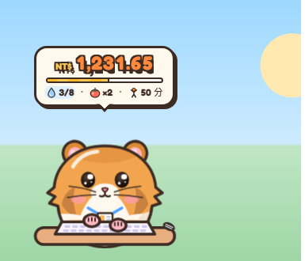

# 錢進中 · desk-earnings-pet

錢進中是一個 Windows 桌面小程式。上班時間，畫面上一秒一秒顯示「今天已經賺到多少錢」，旁邊有一隻小寵物（黃金鼠或貓咪）陪你打字、午休、下班。寵物也會提醒你起來動一動、喝水，想專心時還有番茄鐘。

*A Windows desktop pet that counts what you have earned today, second by second, and reminds you to stand up, drink water and focus with a pomodoro timer. The UI is in Traditional Chinese.*

<p align="center">
  
  
</p>

## 功能

- **即時收入**：輸入月薪或時薪，上班時間內金額每秒增加，也會顯示距離下班還有多久（HH:MM:SS）。
- **小寵物**：黃金鼠和貓咪，各 5 種畫風。牠們會打字、午休、喝水、慶祝下班，也可以餵點心。
- **休息提醒**：
  - 起來動：坐太久會提醒你起來動一動。
  - 喝水：記一杯水，並提醒你補水。
- **番茄鐘**：一鍵開始專心，長按停止。
- **8 種版型**：從完整視窗到螢幕頂端的小膠囊都有，可以隨時切換。
- **隱藏金額**：點一下金額就換成 \*\*\*，版面不會移動。也可以隱藏整個視窗，或讓視窗不被截圖。
- **縮放比例**：70% 到 150%，所有版型一起放大縮小；在視窗上按住 Ctrl 轉滾輪也可以。
- **只有一個 exe**：不用安裝，也不需要系統管理員權限。薪資資料只存在這台電腦裡，不會上傳。

## 版型

| 視窗類 | | |
|---|---|---|
| 1 經典直式 | 2 遊戲畫面 | 3 健康儀表板 |
|  |  |  |
| 4 番茄鐘優先 | | |
|  | | |

| 小巧類 | | | 桌面類 |
|---|---|---|---|
| 5 橫向極簡 | 6 頂端小膠囊 | 7 迷你浮窗 | 8 桌面寵物 |
|  |  |  |  |

畫面中的金額是模擬資料。

## 系統需求

- Windows 10（1903 以後）或 Windows 11。
- Microsoft Edge WebView2 執行階段。Windows 11 已內建，大部分 Windows 10 也已經裝好。如果缺少，程式開啟時會提示下載。
- .NET Framework 4.8，Windows 內建。

## 使用方式

1. 取得 `錢進中.exe`：自己建置（見下方），或從 Releases 下載。
2. 放在固定的資料夾，點兩下開啟。exe 沒有數位簽章，第一次開啟如果出現 SmartScreen，請按「其他資訊」→「仍要執行」。
3. 跟著歡迎畫面設定薪水、寵物和提醒。

完整說明見 [docs/使用說明.md](docs/使用說明.md)。程式裡的「設定」→「其他」→「使用說明」也有同一份說明。

## 建置

不需要 Visual Studio，使用 Windows 內建的 .NET Framework C# 編譯器（`csc.exe`）。

```powershell
.\build.ps1            # 開發版：網頁從 src\web 讀取，WebView2 DLL 放在 exe 旁邊
.\build.ps1 -Release   # 發行版：單一 build\錢進中.exe，所有檔案都包在裡面
```

## 測試

```powershell
.\test.ps1             # 網頁測試（headless Edge）+ 主程式測試，兩邊都通過才回傳 0
.\test.ps1 -WebOnly
.\test.ps1 -HostOnly
```

## 專案結構

```
src/host/     C# 主程式：WinForms + WebView2、透明視窗、系統匣選單、開機啟動、資料存放
src/web/      畫面：HTML/CSS/JS，包含版型、寵物、設定面板與使用說明
tests/        網頁測試（tests/web，在 headless Edge 執行）與主程式測試（tests/host）
tools/        建置與檢查用的小工具（圖示、截圖、CPU 量測、視覺檢查）
vendor/       WebView2 SDK 與 Fredoka 字型
docs/         使用說明、設計規格與實作計畫（docs/superpowers）、原型
assets/       程式圖示
```

## 資料存放

- `%AppData%\錢進中`：你的設定與紀錄，包含薪資。
- `%LocalAppData%\錢進中`：程式自己用的檔案，例如解壓的執行檔案和錯誤紀錄。

程式不會上傳任何資料。平常不連網，只有在你按「設定」→「其他」→「檢查更新」時，才會向 GitHub 查詢一次最新版本（`api.github.com`，只送出一般的 User-Agent，不含任何個人資料）。

## 授權

本專案以 [MIT License](LICENSE) 授權。

第三方元件：
- **Microsoft Edge WebView2 SDK**：BSD 授權，見 [vendor/webview2/LICENSE.txt](vendor/webview2/LICENSE.txt)。
- **Fredoka 字型**：SIL Open Font License 1.1，見 [vendor/fonts/OFL.txt](vendor/fonts/OFL.txt)。
